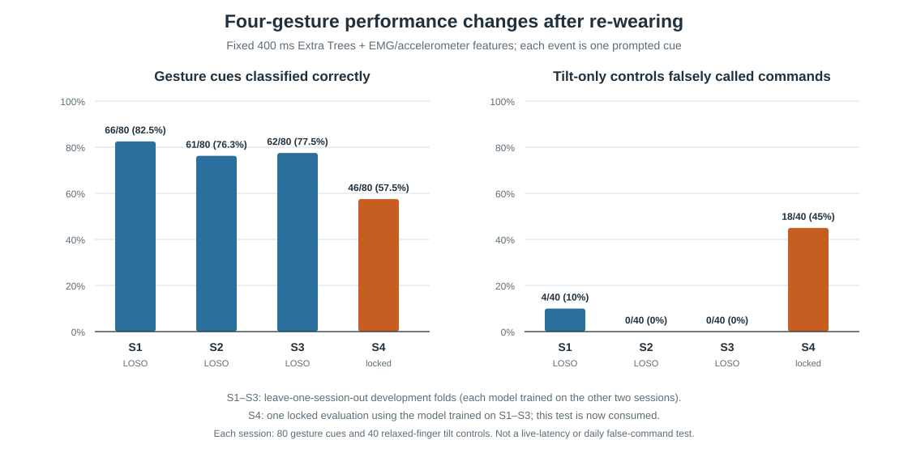
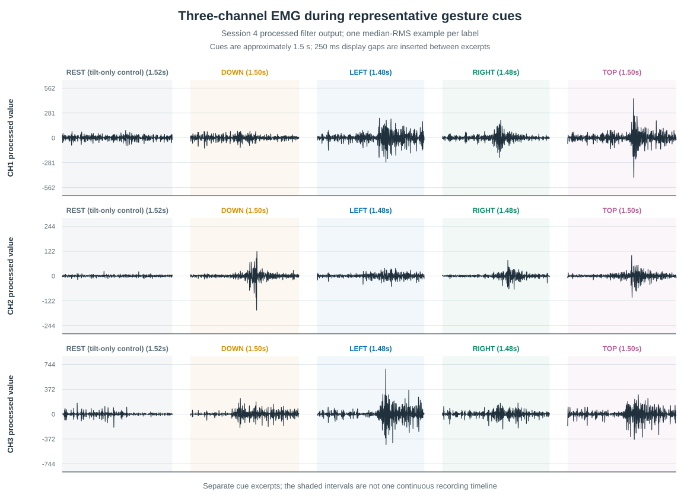
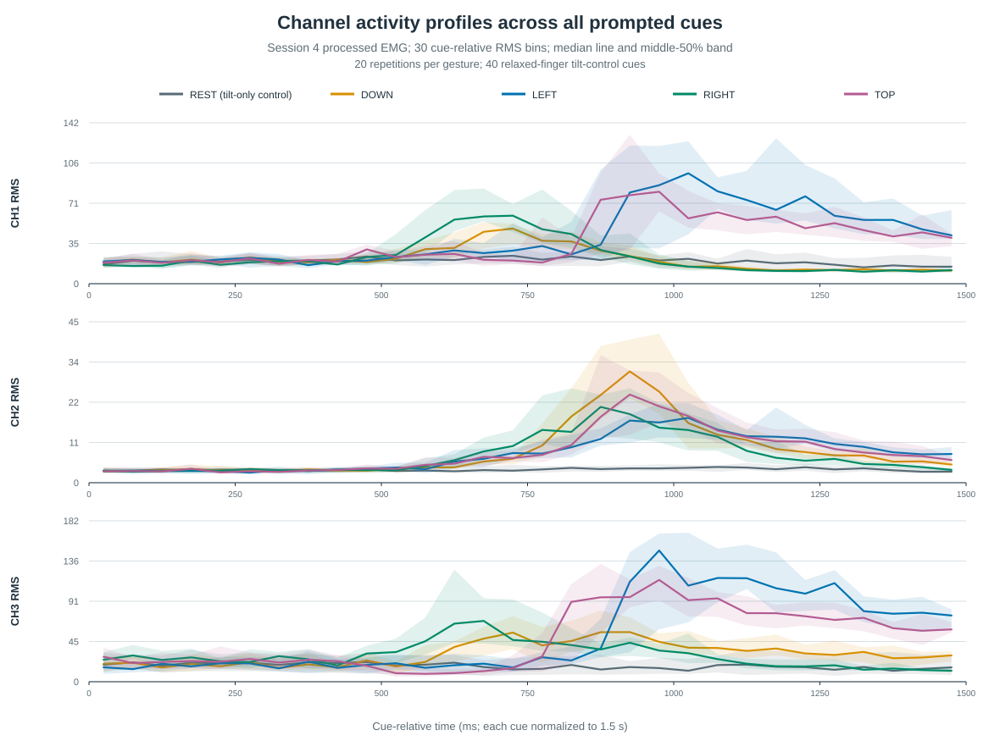

# 3-channel-sEMG

Python tools and experiments for collecting three-channel forearm EMG, testing gesture classifiers, and exploring real-time control with an Upside Down Labs NPG-Lite band.

The acquisition code follows the supplier's NPG-Lite software and BLE data format ([supplier project](https://github.com/upsidedownlabs/NPG-Lite-ArmBand-Software)). The band provides three EMG channels and a LIS3DH accelerometer. Current experiments run on a laptop; embedded inference and BLE HID control are future work.

## Current progress

The BLE pipeline captures three EMG channels plus the accelerometer, but the four-gesture model is not yet reliable across re-wearings. Its locked Session 4 evaluation classified 46/80 gesture cues correctly and falsely triggered on 18/40 tilt-only controls.

See [current project status](docs/PROJECT_STATUS.md) for measured results, assumptions, and next steps, and the [four-gesture report](analysis/exp015_swipe4/README.md) for model and experiment details. The live Flappy Bird demo is a separate fist-clench threshold detector; embedded inference and BLE HID remain future work.

## Results at a glance

These plots summarize held-out cue predictions from the fixed 400 ms Extra Trees model. Sessions 1–3 are leave-one-session-out development folds; Session 4 is the one-time locked evaluation and is now consumed.



### Three-channel EMG signals

These plots use Session 4's processed filter-output channels, not raw ADC counts or calibrated microvolts. The waveform plot shows one median-RMS representative cue per label. The envelope plot summarizes all repetitions; each line is the median RMS and each band is the middle 50% across cues. Cue intervals approximate the movement period and do not provide movement-onset latency.





Recreate the figures with [`plot_readme_results.py`](analysis/exp015_swipe4/plot_readme_results.py) and [`plot_session4_channel_signals.py`](analysis/exp015_swipe4/plot_session4_channel_signals.py) when the local Session 4 recording and cue timeline are available.

The conventional time-domain feature baseline follows established myoelectric pattern-recognition work ([Hudgins et al., 1993](https://pubmed.ncbi.nlm.nih.gov/8468080/)). Project-specific protocol and signal-processing notes are in [`docs/semg_literature_review.md`](docs/semg_literature_review.md). Detailed experiment artifacts remain in the working tree; the source recordings and local trial log are excluded from Git by design.

See [`docs/PROJECT_STATUS.md`](docs/PROJECT_STATUS.md) for the measured results, current assumptions, and planned evaluation steps.

## Repository map

| Path | Contents |
| --- | --- |
| `supplier_toolkit/upstream/` | Preserved supplier source and license |
| `supplier_toolkit/adapted/` | BLE recording, cue collection, segmentation, baseline training, and live demos |
| `scripts/` | Earlier recorder, signal comparison, plotting, and quality-control utilities |
| `analysis/exp015_swipe4/` | Four-swipe segmentation and baseline-training code, protocol notes, and evaluation documentation |
| `analysis/exp016_swipe_shadow/` | Live shadow-mode implementation and local exploratory results |
| `analysis/exp011_single_fist_flap/` | Flappy Bird page and offline fist-clench analysis |
| `docs/` | Project-specific literature review and notes |
| `recordings/`, `raw_packets/`, `training_data/` | Local source recordings and derived biosignal data; not tracked in Git |

Generated signal files, model weights, plots, virtual environments, and machine-specific experiment logs are ignored. Keep a separate backup of source recordings; do not replace an original recording with a processed derivative.

## Run the live Flappy Bird demo

On macOS, create the project environment and install the pinned dependencies:

```bash
python3 -m venv supplier_toolkit/.venv
supplier_toolkit/.venv/bin/pip install -r supplier_toolkit/requirements.lock.txt
```

Start the local BLE bridge from the repository root:

```bash
supplier_toolkit/.venv/bin/python supplier_toolkit/adapted/live_flap_server.py
```

Open [http://127.0.0.1:8767/flap_replay.html](http://127.0.0.1:8767/flap_replay.html), press **Connect & play live**, keep the hand relaxed during the initial two-second baseline, then clench to flap and release to re-arm. **Stop live recording** saves the incoming packet log, raw ADC CSV, and filtered signal CSV. This is a laptop demo; it does not send BLE HID commands.

The live swipe-shadow page is served separately by `supplier_toolkit/adapted/live_swipe_shadow.py` and displays the five classes without controlling the game. Do not run two BLE sessions against the band at the same time.

## Evaluation and data notes

Training, validation, and test partitions should keep complete repetitions or sessions apart before overlapping windows are formed. The selected four-swipe model has only a same-wearing test result; additional re-wear sessions are needed for a stronger generalization check. The project tracks event misses, extra activations, and measured action latency separately from window classification scores. These choices follow the project's cited leakage analysis and grouped-splitting guidance ([EMG splitting study](https://pmc.ncbi.nlm.nih.gov/articles/PMC9797837/), [scikit-learn GroupKFold](https://scikit-learn.org/stable/modules/generated/sklearn.model_selection.GroupKFold.html)).

## Licenses and references

Supplier source retains its original license in [`supplier_toolkit/upstream/LICENSE`](supplier_toolkit/upstream/LICENSE). Adapted supplier files and associated notices are in [`supplier_toolkit/adapted/`](supplier_toolkit/adapted/).

- [Upside Down Labs NPG-Lite ArmBand Software](https://github.com/upsidedownlabs/NPG-Lite-ArmBand-Software)
- Hudgins, Parker, Scott, “A new strategy for multifunction myoelectric control,” *IEEE Transactions on Biomedical Engineering* (1993), [PubMed](https://pubmed.ncbi.nlm.nih.gov/8468080/).
- [EMG data-splitting and window leakage study](https://pmc.ncbi.nlm.nih.gov/articles/PMC9797837/).
- [scikit-learn GroupKFold documentation](https://scikit-learn.org/stable/modules/generated/sklearn.model_selection.GroupKFold.html).
